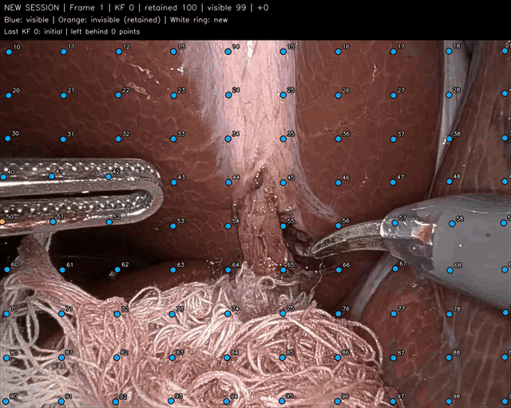

# LiteTracker: Leveraging Temporal Causality for Accurate Low-latency Tissue Tracking


*Official code repository for **LiteTracker: Leveraging Temporal Causality for Accurate Low-latency Tissue Tracking**; published at **MICCAI 2025**.*

📑 **[arXiv](https://arxiv.org/abs/2504.09904)**

We propose LiteTracker, a low-latency method for tissue tracking in endoscopic video streams. LiteTracker builds on a state-of-the-art long-term point tracking method, and introduces a set of **training-free runtime optimizations**. These optimizations enable online, frame-by-frame tracking by leveraging **a temporal memory buffer** for efficient feature reuse and utilizing prior motion for **accurate track initialization**. LiteTracker demonstrates significant runtime improvements being around **7x faster than its predecessor and 2x than the state-of-the-art**. Beyond its primary focus on efficiency, LiteTracker delivers high-accuracy tracking and occlusion prediction, performing competitively on both the STIR and SuPer datasets.

## Changes in this fork

This fork adds query management for a future VSLAM integration and supports
development on macOS. LiteTracker still performs frame-by-frame point tracking.

- **Managed tracker:** `src/managed_lite_tracker.py` adds stable IDs, query
  insertion and a per-session query cap.
  Invisible queries keep their history and can recover within a session.
  A keyframe starts a fresh session with selected visible IDs and new queries.
  All appearance and temporal caches restart, including those of carried points.
  There is no per-track removal API within a running session.
- **Separate demo:** `managed_demo.py` starts with the same 100-point grid as
  `demo.py`. An external controller simulates keyframes and adds queries from
  uniform grid locations only on those frames. Visible points keep their external
  IDs across sessions; lost points are left behind at the boundary.
- **Inspection and tests:** solid point markers, per-frame JSONL logs, summary
  timings, and tests cover insertion, retention, and the keyframe policy.
- **Mac development:** platform-specific dependencies and MPS execution with CPU
  fallback for unsupported operations; see the setup instructions below.

There is no camera-pose estimation, stereo matching or 3D landmark management in
this addition. A future VSLAM controller can replace the demo's keyframe rules.
The original `demo.py` remains available.



Six seconds from the bundled demo, at original playback speed. At each keyframe,
visible points keep their IDs in a fresh tracker session; lost points are left
behind and new grid points fill gaps. Blue means visible, orange means invisible,
and white rings mark newly added points.

## Getting Started
1. Install the required packages using via [uv](https://docs.astral.sh/uv/getting-started/installation/):
```bash
uv sync
```
2. Download the pre-trained weights or train your own CoTracker3 Online model via the official [repository](https://github.com/facebookresearch/co-tracker). In our experiments, we used the [scaled weights](https://huggingface.co/facebook/cotracker3/resolve/main/scaled_online.pth) from the official repository.

3. For evaluation, download the STIR Challenge 2024 and Super datasets:
   - [STIR Challenge 2024](https://stir-challenge.github.io//stirc-2024/) and [dataset](https://zenodo.org/records/14803158)
   - [SuPer Framework website](https://sites.google.com/ucsd.edu/super-framework/) and [dataset](https://drive.google.com/open?id=1fRepcpd9tFpRoi2G7G-w9uwo7eScG9LI)


### Developing on macOS

Use Python 3.12 with the pinned dependencies:

```bash
uv sync --python 3.12
```

The demo selects Apple MPS when available, otherwise CPU, and runs in float32.
PyTorch 2.7.1 lacks MPS support for the tracker's 3D grid sampling operation.
The demo enables CPU fallback for unsupported MPS operations before importing
PyTorch; supported operations still use MPS. For your own scripts, launch with
`PYTORCH_ENABLE_MPS_FALLBACK=1 uv run your_script.py`, or use `device="cpu"`.
MPS timing synchronizes pending GPU work before and after each measured call.
NVIDIA CUDA libraries and Triton are installed only on Linux x86_64; the existing
CUDA dependency versions are preserved there. ONNX Runtime uses the GPU package
on Linux x86_64 and the standard package on macOS. CUDA BF16 acceleration is
used only on compatible NVIDIA GPUs.

## Inference and Evaluation
### Managed tracking and keyframe demo

`src/managed_lite_tracker.py` provides a thin PyTorch wrapper with stable point
IDs, explicit insertion, and a per-session query cap. An external controller
selects keyframes. There is no per-track removal operation within a session.

```python
from src.managed_lite_tracker import ManagedLiteTracker

tracker = ManagedLiteTracker(model.eval(), max_points=512)
# queries: [1, N, 3] = absolute start frame, input-image x, input-image y
ids = tracker.add_queries(queries)
coords, visible, confidence = tracker(frame)  # one RGB frame [1,3,H,W]
output_ids = tracker.track_ids

# When an external controller chooses THIS processed image as a keyframe:
# keep_ids selects its visible, finite, in-bounds observations.
# new_points: [1, M, 2], grid locations in THIS image.
coords, visible, confidence = tracker.start_keyframe(keep_ids, new_points)
output_ids = tracker.track_ids  # carried IDs followed by newly allocated IDs
# Next, call tracker(next_frame), not tracker(frame) again.
```

`forward(frame, queries)` accepts initial queries; later, omit queries or supply
`tracker.queries`. Changed query tensors are rejected. `add_queries()` can append
queries with absolute start times at or after `tracker.frame_index`, preserving
existing cache values. New active queries can still change other points'
predictions through shared attention. This cache-preserving insertion API is
distinct from a keyframe handover: the demo adds only at keyframes, where it
reinitializes the entire session.

`start_keyframe()` ends the whole session and starts another on the **last
processed image**. The wrapper remembers that image and its observations, so
carried queries use positions measured in the correct frame. Selected visible
points keep their external IDs; new points receive monotonically allocated IDs;
IDs omitted from the new session are never reused within the video. Unknown,
duplicate, invisible, nonfinite, out-of-bounds or over-capacity selections are
rejected before resetting. Pending additions must be processed before a boundary.

The new session discards **all neural appearance and temporal memory**, including
that of surviving points. It primes the backend on the boundary image and returns
predictions for that same absolute frame. The public `frame_index` does not
advance again, while the backend clock restarts and `session_index` increments.
Each noninitial keyframe therefore uses two inference calls: track the image in
the old session, then prime the new one on that image. This preserves external
point identity, not neural history or a guarantee of identical predictions.
Repeated handovers on the same image are rejected.

Outputs keep LiteTracker's tuple format: coordinates `[1,1,N,2]`, boolean visibility
`[1,1,N]`, and confidence `[1,1,N]`. Save an ID snapshot with each output because
point count and order may change at a boundary. In the current backend, boolean
visibility is `sigmoid(visibility_logit) * sigmoid(confidence_logit) > 0.6`.
The demo adds no separate confidence cutoff; it also requires finite in-bounds
coordinates. Future queries are reported invisible until their start frame.
The wrapper does not maintain per-point invisibility counters.

Invisible points remain in the model until a session boundary, allowing recovery
between keyframes. At a boundary, only current usable observations are carried;
all others are left out, even if their loss is temporary. Total loss can start a
new grid with fresh IDs, but provides no correspondence bridge to the old session.
A future VSLAM controller must decide how to handle that case; no SLAM map or world
frame exists in this demo.

Configure device/eval mode before tracking and keep resolution fixed. Empty
sessions advance the public clock while pausing the backend; absolute query times
account for this offset. `reset()` explicitly begins a new independent video,
restarting IDs and the public clock; the keyframe controller uses `start_keyframe()`
instead. Memory is bounded by the per-session query cap and LiteTracker's history
window, plus one saved image and its latest predictions for the handover.

Run the full bundled 24-second clip:

```bash
uv run managed_demo.py --video assets/stir-5-seq-01.mp4 \
  --checkpoint weights/scaled_online.pth --max-frames 600 \
  --max-points 512 --target-points 100 --grid-size 10 \
  --output results/managed_keyframe_sessions_full
```

| Demo option | Default | Meaning |
| --- | --- | --- |
| `--max-points` | 512 | Maximum queries in one session, including invisible ones |
| `--target-points` | 100 | Desired query count after keyframe top-up |
| `--grid-size` | 10 | Grid side length; 10 gives 100 initial points |
| `--min-distance` | 15 | Exclusion radius in input-image pixels for new queries |
| `--kf-min-gap` | 15 | Minimum frames between keyframes |
| `--kf-max-gap` | 60 | Maximum frames between keyframes |
| `--kf-survivor-ratio` | 0.75 | Trigger below this fraction of the last keyframe's usable IDs |
| `--kf-coverage-ratio` | 0.75 | Trigger below this fraction of the last keyframe's occupied image cells |
| `--kf-patience` | 3 | Consecutive low-measurement frames required |
| `--max-frames` | 300 | Maximum input frames to process |

Keyframe patience belongs to the VSLAM policy, not the tracker wrapper. The
demo's external `TrackingController` stands in for that policy until VSLAM
integration. It measures usable observations and coverage over a 4×4 image grid.
A sustained drop below either ratio triggers a keyframe subject to the minimum
gap; the maximum gap also triggers one. Decisions use the **current frame's old
session output**. The first frame is always a keyframe. Later keyframes carry
current usable points and top up towards `target_points`, then reset the reference
IDs and coverage for the new session. An interval keyframe restarts the session
even when it needs no new points.

Initial and additional queries use the same uniform grid helper as `demo.py`,
without feature detection. Candidates must be more than `min_distance` pixels from
carried current-frame positions and newly chosen sites; farthest candidates are
selected first. Fewer points may be added if grid sites or capacity run out.
Omitted old queries free capacity only when the whole session is replaced. There
is no mid-session expiry or forced deletion. These rules simulate keyframes;
they do not estimate camera poses or maintain SLAM landmarks.

Outputs: `tracks.mp4`, `frames.jsonl`, and `summary.json`. Logs contain session
indices, keyframe reasons, IDs carried/added/dropped, old-session usable positions,
new-session predictions and timing. Filled blue circles mean visible;
orange means invisible but retained until the next boundary; white rings mark
newly allocated IDs. The NEW SESSION banner stays visible for one second, and
the latest keyframe reason and dropped count remain in the header.

```bash
uv run python -B -m unittest discover -s tests -v
uvx ruff check src/managed_lite_tracker.py managed_demo.py tests
```

Tests cover cache preservation during insertion, retention/recovery within a
session, same-image handovers, stable carried IDs, fresh memory, absolute/backend
clock alignment, empty sessions, capacity, invalid requests and keyframe rules.
They verify query management, not tracking accuracy. `processing_ms` includes
tracking, the controller, keyframe reinitialization, and device synchronization;
it excludes decoding and rendering. This differs from the older `tracker_ms`,
which excluded controller/insertion costs. Mac uses MPS with CPU fallback.

Query management stays outside an eventual ONNX/TensorRT graph. A backend cache
adapter/export and numerical validation are still required for those runtimes.

### Demo and runtime analysis
The demo script runs LiteTracker on a video in a stream-line fashion, produces a video with tracking results, and prints the runtime statistics.
```bash
uv run demo.py -w <path/to/weights.pth> -v assets/stir-5-seq-01.mp4 -s 20 -q 0
```

### STIR Challenge 2024
STIR evaluation scripts are based on the official [repository](https://github.com/athaddius/STIRMetrics/tree/STIRC2024). Minimal modifications are made to accommodate within our framework.
```bash
bash ./launch_eval_stir.sh <path/to/STIRDataset> <path/to/weights.pth>
```

### SuPer
```bash
uv run ./src/eval/super/eval_super.py -d <path/to/SuPerDataset> -w <path/to/weights.pth>
```

### Unpublished Results on Non-surgical Datasets
LiteTracker also performs competitively on natural scenes benchmarks. Latency values are computed on a single RTX3090, as 95th percentile of the measurements, tracking 1024 points.
<table>
  <tr>
    <th rowspan="2">Method</th>
    <th colspan="3">DAVIS</th>
    <th colspan="3">RGB-S</th>
    <th colspan="3">Kinetics</th>
    <th colspan="3">RoboTAP</th>
    <th colspan="3">Dynamic Replica</th>
    <th rowspan="2">Latency (ms) ↓</th>
  </tr>
  <tr>
    <th>AJ↑</th><th>δ_avg^vis↑</th><th>OA↑</th>
    <th>AJ↑</th><th>δ_avg^vis↑</th><th>OA↑</th>
    <th>AJ↑</th><th>δ_avg^vis↑</th><th>OA↑</th>
    <th>AJ↑</th><th>δ_avg^vis↑</th><th>OA↑</th>
    <th>δ_avg^occ↑</th><th>δ_avg^vis↑</th><th>Surv.↑</th>
  </tr>
  <tr>
    <td>CoTracker3 (Online)</td>
    <td>63.8</td><td>76.3</td><td>90.2</td>
    <td>71.7</td><td>83.6</td><td>91.1</td>
    <td>55.8</td><td>68.5</td><td>88.3</td>
    <td>66.4</td><td>78.8</td><td>90.8</td>
    <td>40.1</td><td>73.3</td><td>94.4</td>
    <td>200.98</td>
  </tr>
  <tr>
    <td>TrackOn (48)</td>
    <td>65.0</td><td>78.0</td><td>90.8</td>
    <td>71.4</td><td>85.2</td><td>91.7</td>
    <td>53.9</td><td>67.3</td><td>87.8</td>
    <td>63.5</td><td>76.4</td><td>89.4</td>
    <td>-</td><td>73.6</td><td>-</td>
    <td>74.80</td>
  </tr>
  <tr>
    <td><strong>LiteTracker</strong></td>
    <td>62.0</td><td>74.6</td><td>88.4</td>
    <td>71.0</td><td>81.7</td><td>86.7</td>
    <td>54.4</td><td>66.9</td><td>85.7</td>
    <td>63.6</td><td>76.7</td><td>87.5</td>
    <td>38.5</td><td>71.5</td><td>93.9</td>
    <td>29.67</td>
  </tr>
</table>

## Acknowledgements
Special thanks to the authors of [CoTracker3](https://cotracker3.github.io/), [MFT](https://github.com/serycjon/MFT), [STIR Challenge](https://stir-challenge.github.io/), and [SuPer Framework](https://sites.google.com/ucsd.edu/super-framework/) that made this work possible.

Please cite our work if you use LiteTracker in your research:
```
@inproceedings{karaoglu2025litetracker,
  title={LiteTracker: Leveraging Temporal Causality for Accurate Low-Latency Tissue Tracking},
  author={Karaoglu, Mert Asim and Ji, Wenbo and Abbas, Ahmed and Navab, Nassir and Busam, Benjamin and Ladikos, Alexander},
  booktitle={International Conference on Medical Image Computing and Computer-Assisted Intervention},
  pages={308--317},
  year={2025},
  organization={Springer}
}
```


